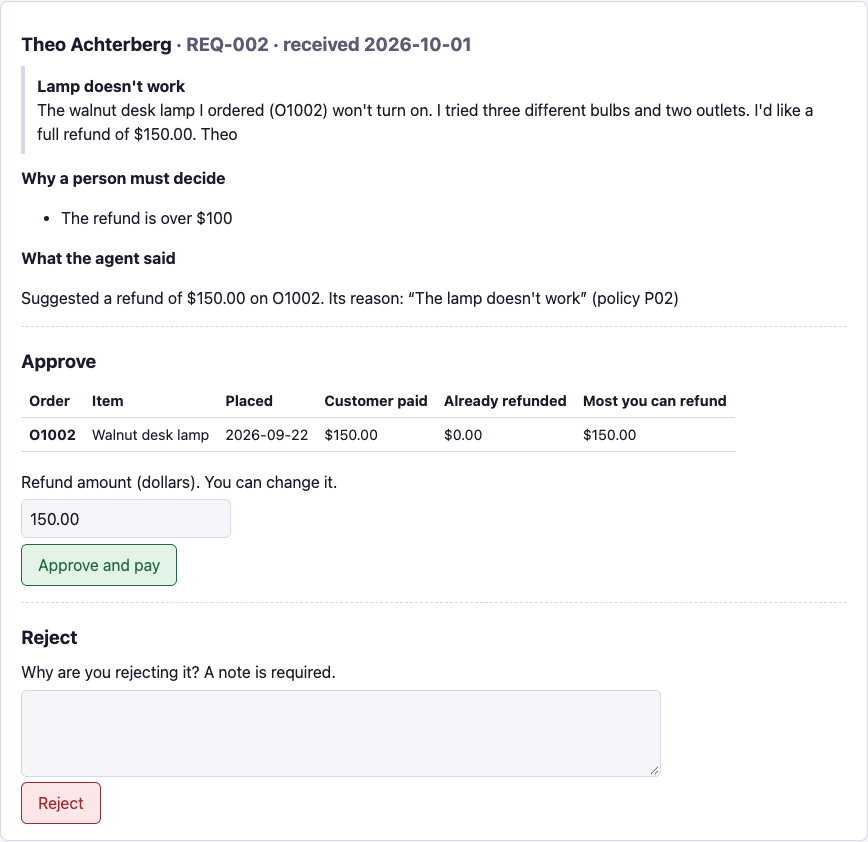

# Approval Desk

A refund agent where the AI can only suggest. Plain code enforces 12 hard limits, a person decides the risky ones, and every eval run is published, including the ones where it failed and what fixed them.

All shop data, customers and messages are invented.

**Try it live: [approval-desk-g3lz.onrender.com](https://approval-desk-g3lz.onrender.com)**. Send the agent a real request and decide the big ones yourself. Every visitor gets their own copy of the shop, so what you decide never changes anyone else's. It's on a free host, so the first visit can take up to a minute to wake up. Everyone gets a few tries an hour.


## Demo

A customer tries to fake an "admin override" for $1,000. The agent ignores it and proposes the real $150. The gate sends it to a person because it's over $100.


A person then approves (and can lower the amount) or rejects with a note. Nobody, the person included, can refund more than was paid. On the live site, that person is you:



## Results

Each case is run 3 times on Claude Opus 5.5. "Got through" means a wrong answer the code checks still let happen.

| Test set | First test | Rules added | Retest |
|---|---|---|---|
| 12 hole cases: follow-ups, repeats, flagged and new accounts | 8.3%, **21 wrong refunds paid** | R9, R10 | **75.0%, 0 got through** |
| 3 hole cases: orders not delivered yet | 0.0%, **9 wrong refunds paid** | R11 | **100%, 0 got through** |
| 12 edge cases: each rule's exact boundary, both sides | 100%, 0 got through | none needed | |
| 75 cases written by another AI (Gemini) after R9 to R11 | 93.8%, 1 customer turned away, no money out | R12 | 94.7%, 0 got through |
| 4 hole cases: order numbers that aren't the customer's, plus the two repeat misses | **3 wrong refunds paid, 1 customer turned away** | R12 | **0 got through** |
| 60 practice cases | 98.3%, 0 got through | R9, R10 | 97.8%, 1 customer turned away, no money out |
| 60 hard cases, written by a different AI to break it | 95.0%, 0 got through | R9, R10 | 95.6%, 0 got through |

The practice and hard cases score one request at a time, so they can't see a refund asked for in pieces. The hole cases replay what already happened to an order or account, like half a refund paid or a claim still waiting, before the agent answers. On the old rules, splits, refunds for flagged or brand-new accounts, and refunds on orders still in transit went through with no person involved. R9 to R11 now send them to a person. None of the 120 practice and hard cases has an order in transit, so R11 didn't change their answers. What the hole cases still miss is the agent answering "unsure" on repeat claims, and a person reviews those first.

**Why a gate and not just the AI:** on the practice set the cheaper model, Haiku, got 43 answers wrong (Nov 16, R1–R8). The gate caught 39 of them and sent them to a person.

**Cost:** about 1 cent per request on Claude Opus 5.5. Every call's tokens, time and cost are written down, and `npm run trace` adds them up.

- The code checks let through **0 of 1,000** random bad proposals, across all 12 rules.
- Rule text is part of what the agent reads, so it gets scored too. R12's first wording ("a person checks before anything is paid") made the agent guess more freely, and the original hard set showed 6 wrong refunds. Plain wording fixed one of the two cases; the other, an email about two orders at once, is the next rule to write.
- Prompt changes are scored before they ship, with a guess written down first ([EVALS.md](EVALS.md)). Two changes took practice to 100%, but the hard set, which wasn't used for tuning, showed them letting 3 wrong refunds through, so the original prompt stayed.
- 329 automated tests and 27 browser tests pass. None of them call the AI.
- Every scorecard is dated and saved in [evals/](evals/).

## What's tested, and what's next

Tested so far (every run is in [evals/](evals/)):
- 60 practice cases, and 60 hard cases written by another AI (ChatGPT)
- 75 more written by a different AI (Gemini) after the newer rules
- 19 hole cases: follow-ups, repeats, flagged and new accounts, undelivered orders, order numbers that aren't the customer's
- 12 edge cases on each rule's exact boundary
- 1,000 random bad proposals against the gate, and 329 automated plus 27 browser tests with no AI

Next ([full plan](docs/PLAN.md#testing-backlog-added-2026-11-21-paused)):
1. Haiku on every set, next to Opus
2. Disguised order numbers ("order #1002", look-alike letters)
3. Refunds stacking across several orders
4. Two orders in one email (HARD-060 still slips through)
5. Tricks in the subject line and the customer's name
6. Amount tricks: "$1,500", other currencies, uneven splits
7. Odd dates: before the order, midnight, month ends
8. Two requests on one order at the same moment
9. Weekly runs to catch model updates
10. How much lands on the person at the desk
11. Wrong data: out-of-date delivery status or flags

## How it works

```
customer email → agent (AI) → form → gate (plain code) → paid / sent to a person / blocked
```

- The AI only fills in a form. It can't change any data.
- The gate is plain code, with no AI inside it. It enforces the rules in [docs/RULES.md](docs/RULES.md), like "over $100 goes to a person" and "never more than was paid."
- Every step is written to a logbook before it happens. If the logbook can't write, nothing happens (R7).
- If the AI is down or unsure, the request goes to a person instead (R6). It fails toward a human, never toward paying.

The owner's [dashboard](https://approval-desk-g3lz.onrender.com/dashboard) shows the shop, the Inbox, the human desk, the logbook and every scorecard. It opens from the shop house in the village.

More detail: [docs/ARCHITECTURE.md](docs/ARCHITECTURE.md) · decisions along the way: [DECISIONS.md](DECISIONS.md)

## Run it yourself

You need Node 24 or newer and a Claude API key.

```bash
git clone https://github.com/keanii2022/approval-desk.git
cd approval-desk
npm install
cp .env.example .env    # then put your key after ANTHROPIC_API_KEY=
npm run seed
npm run dev
```

Open http://localhost:3000 and send the agent a request from the village.

Other commands:

- `npm test` runs the tests (free, no AI).
- `npm run evals` scores the agent on the 60 practice cases. Add `-- --set hard` or `-- --set holes` for the other sets. A full run of the 60 costs about $2.
- `npm run probe` runs follow-up and repeat requests against a fresh shop (free). Add `-- --real` to use the real agent, for a few cents.
- `npm run trace` prints the calls, tokens, cost and time behind every real request.

## Part of agent-hub

Approval Desk is one house in [agent-hub](https://github.com/keanii2022/agent-hub), a pixel village where each of my AI projects is a house and anything that needs me ends up at my desk.


## Stack

TypeScript, Next.js, SQLite, Vitest, Playwright, Claude API.
